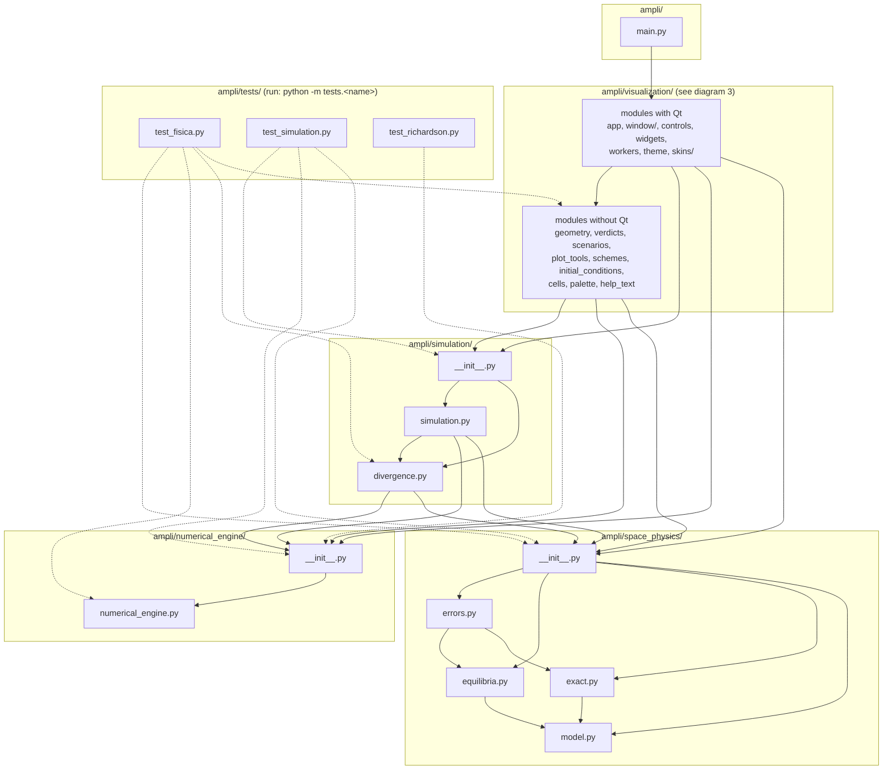
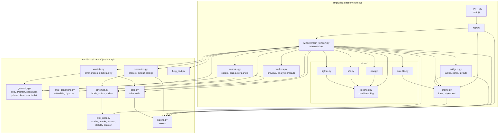

# Software flow chart

Diagrams of the code in `ampli/`. Every box shows the folder and file it belongs to.

Start the program from the repository root:

```bash
python main.py
```

## 1. Runtime flow

What happens from `python main.py` to each redraw of the interface.

```mermaid
flowchart TD
    START([python main.py]) --> MAIN

    subgraph ROOT["ampli/ (root)"]
        MAIN["main.py<br/>calls visualization.main()"]
    end

    subgraph VIS["ampli/visualization/"]
        VINIT["__init__.py<br/>main(): loads app.py on demand"]
        APP["app.py<br/>create QApplication,<br/>theme.setup_fonts(), stylesheet,<br/>MainWindow"]
        LOOP{{"Qt event loop<br/>app.exec()"}}
        USER["controls.py<br/>user edits I, ω0, Δt, method<br/>→ SimConfig"]
        TICK["window/main_window.py<br/>MainWindow._tick() (QTimer)"]
        DRAW["window/main_window.py<br/>redraw: ω(t), drifts, errors,<br/>3D body (skins/), tables"]
    end

    subgraph SIM["ampli/simulation/"]
        RESET["simulation.py<br/>Simulation.reset()"]
        ADV["simulation.py<br/>advance_to() → advance(n)"]
        INTEG["simulation.py<br/>integrate(): builds f, jac, stop"]
        DIVSTOP["divergence.py<br/>stop_criterion()<br/>Σ|ω| ≥ 1e6 or non-finite"]
        DIVFIRST["divergence.py<br/>first_divergence(Y, bound)<br/>‖ω‖ > 1e3·√(2T/I_min)"]
        DIVTHR["divergence.py<br/>omega_threshold(I, ω0)"]
        HIST["simulation.py<br/>store history:<br/>Y, ΔT, Δ‖L‖, errors"]
    end

    subgraph PHYS["ampli/space_physics/"]
        MODEL["model.py<br/>make_rhs (Euler + quaternion),<br/>make_jacobian, initial_state,<br/>conserved_quantities, omega_bound"]
        EXACT["exact.py<br/>EulerExact (Jacobi elliptic)<br/>error_parts: modulus, phase, lag"]
        ERRS["errors.py<br/>conservation_drift"]
    end

    subgraph ENG["ampli/numerical_engine/"]
        NEINT["numerical_engine.py<br/>integrate() → cauchy_problem()"]
        STEP["numerical_engine.py<br/>step: Euler / implicit Euler /<br/>Crank–Nicolson / RK4 (Newton)"]
        STOPQ{"stop(u)?"}
    end

    MAIN --> VINIT --> APP --> LOOP
    LOOP --> USER --> RESET
    RESET --> MODEL
    RESET --> DIVTHR --> MODEL
    RESET --> EXACT
    LOOP --> TICK --> ADV
    ADV --> INTEG
    INTEG --> MODEL
    INTEG --> DIVSTOP
    INTEG --> NEINT --> STEP --> STOPQ
    STOPQ -- "no, steps left" --> STEP
    STOPQ -- "yes → fill NaN" --> DIVFIRST
    STOPQ -- "done" --> DIVFIRST
    DIVFIRST -- "diverged → trim, freeze" --> HIST
    DIVFIRST -- "ok" --> HIST
    HIST --> ERRS
    HIST --> EXACT
    HIST --> DRAW --> LOOP
```



Divergence of ω is checked twice:

1. **During integration.** `simulation/divergence.py` defines `stop_criterion`. `numerical_engine/numerical_engine.py` evaluates it after every step and fills the remaining rows with NaN once it triggers.
2. **After each block.** `first_divergence` trims the block at the first row where ‖ω‖ exceeds 10³ times the maximum possible on the exact orbit (`omega_bound` in `space_physics/model.py`) and freezes the simulation.

## 2. Module map: packages (imports)

Arrows always point to a lower layer and there are no cycles. `numerical_engine` and `space_physics` do not import each other; only `simulation` combines them. The inside of `visualization/` is shown in diagram 3.



## 3. Module map: inside `visualization/`

Modules without Qt (left) never import modules with Qt (right), so they can be imported and tested without PySide6. Arrows from these modules to `space_physics`, `numerical_engine` and `simulation` are left out for clarity.



## Notes

- **Analysis branches outside the live loop.** `visualization/window/main_window.py` also calls `simulation/simulation.py` for `run_preview` (background `PreviewWorker` in `visualization/workers.py`), `richardson_report` and `convergence_report` (`AnalysisWorker`).
- **Analysis panels.** `visualization/window/main_window.py` and `visualization/verdicts.py` call `space_physics/equilibria.py` (equilibria, eigenvalues, separatrix) and `space_physics/errors.py` (linear error theory) directly. These depend only on I and ω₀, not on the integrated trajectory, so they are outside the `_tick` cycle.
- **Callbacks, not imports.** At runtime the engine calls back into physics (`f`, `jac`) and into `divergence` (`stop`). It receives these as functions built by `simulation/simulation.py` and never imports those modules.
- **Fonts.** `visualization/theme.py` chooses `UI_FONT` and `MONO` in `setup_fonts()` once the Qt application exists; other modules read them as `theme.UI_FONT` / `theme.MONO`.
- **Tests.** Run them from the root as modules: `python -m tests.test_fisica`, `python -m tests.test_simulation`, `python -m tests.test_richardson`.
