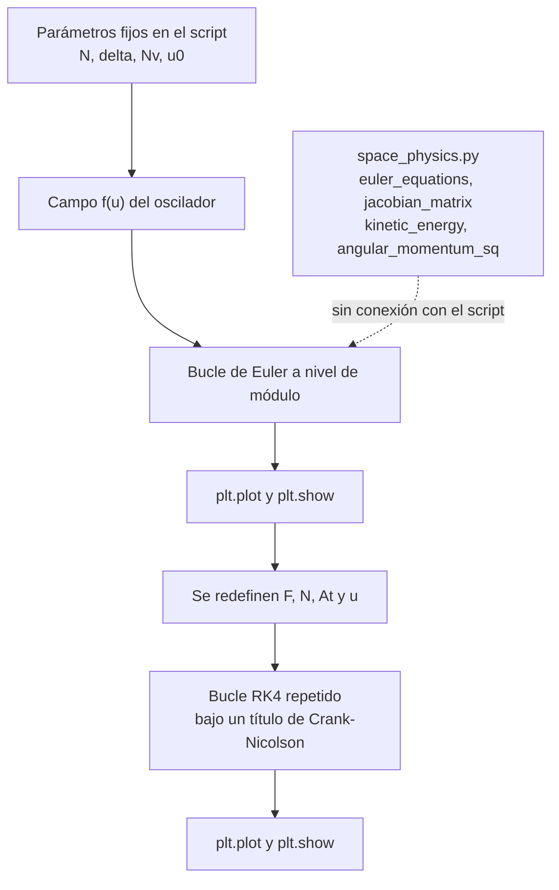
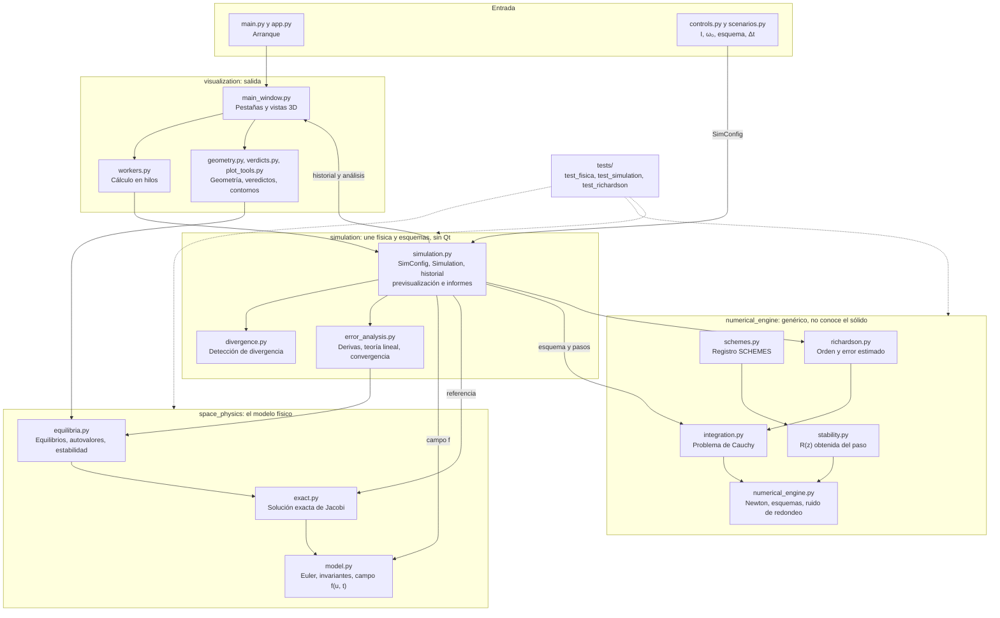

# Evolución del código: del código spaghetti a la arquitectura final

## Evolución cronológica

```mermaid
flowchart LR
    F1["<b>1. Scripts monolíticos</b><br/>24–30/09<br/>Código ejecutado al importar<br/>Sin funciones de integración"]
    F2["<b>2. Extracción de funciones</b><br/>30/09–02/10<br/>euler y runge_kutta_4 como funciones<br/>Primer test de Richardson"]
    F3["<b>3. Interfaz monolítica</b><br/>03–10/10<br/>GUI PySide6 en un solo archivo<br/>De 1382 a 3891 líneas"]
    F4["<b>4. Separación y tests</b><br/>12–25/10<br/>Cálculos movidos a space_physics<br/>test_fisica y Newton"]
    F5["<b>5. Capas</b><br/>27/10<br/>simulation.py sin Qt<br/>Dibujo devuelto a la GUI"]
    F6["<b>6. Paquetes</b><br/>30/10–02/11<br/>Cuatro paquetes y tests/<br/>GUI dividida en módulos"]

    F1 -->|"funciones reutilizables"| F2
    F2 -->|"interacción en tiempo real"| F3
    F3 -->|"física fuera de la GUI"| F4
    F4 -->|"lógica independiente de Qt"| F5
    F5 -->|"modularización"| F6
```

## Arquitectura inicial

Versión del commit `a019b73`, archivo `numerical_engine.py`.

## Arquitectura final

Las flechas muestran las dependencias principales, no todas las importaciones.

